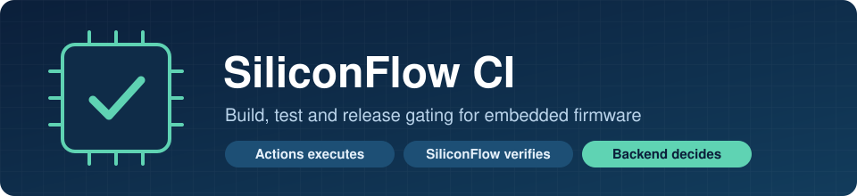
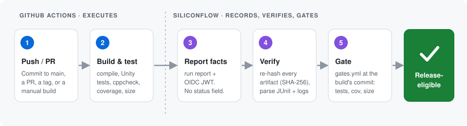
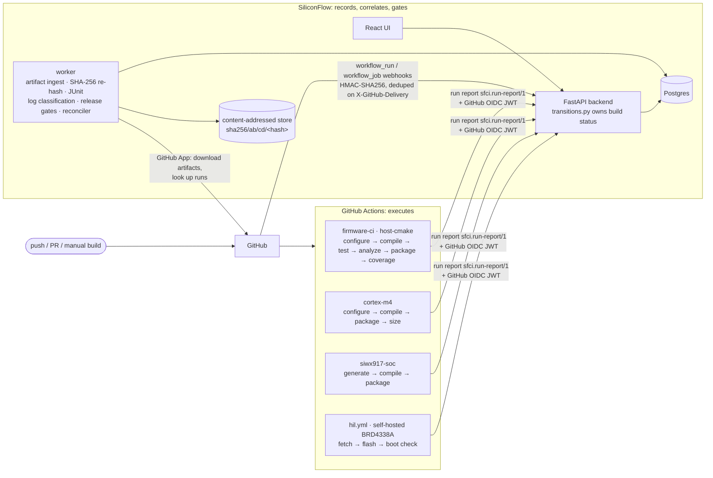

<p align="center">
  
</p>

# SiliconFlow CI

<p>
  
  
  
  
  
  
</p>

**Build, test and release gating for embedded firmware. GitHub Actions runs the builds. SiliconFlow records the results and decides what can ship.**

## At a glance

> **In one sentence:** CI tells you the job went green. SiliconFlow tells you
> whether *this exact binary* is allowed to ship, and if not, exactly why.

| | What it means |
| --- | --- |
| 🏗️ **Actions builds** | Firmware is compiled and tested in GitHub Actions. The backend never runs your code. |
| 📋 **Runners report facts** | Each job sends a signed *run report*: stages, exit codes, coverage, sizes, hashes. No pass/fail opinion. |
| 🔐 **Everything is verified** | OIDC JWTs for reports, HMAC-SHA256 for webhooks, SHA-256 re-hash of every artifact. |
| ⚖️ **The backend decides** | Build status and release eligibility are computed on the server, in one place. |
| 🚦 **Gates block bad releases** | Test failures, coverage, cppcheck errors and flash size are checked against `gates.yml`. |
| 🔎 **Failures are explained** | Logs are classified (`compile_error`, `link_error`, `infra_hw`, ...) and linked to the first error line. |

<p align="center">
  
</p>

## The problem

Embedded teams ship binaries that get flashed onto devices they can't easily
recall, but their CI usually answers only one question: did the job go green?
Release engineers then have to answer the rest by hand. Is this `.bin` the one
CI actually built? Did it fit in flash on the Cortex-M4 target? Did coverage or
static analysis get worse? Did the board boot the right commit? Was the red
build a firmware bug, or a flaky runner or a missing J-Link? The answers end up
spread across Actions logs, artifact zips and spreadsheets. SiliconFlow
collects them in one place, verifies them on the server, and turns them into a
single answer: is this artifact release-eligible, and if not, why not.

## Architecture: Actions executes, SiliconFlow gates



The design rests on one rule: **runners report facts, and only the backend
reaches a verdict.**

- **The backend never runs user code.** Builds run in GitHub Actions inside a
  pinned toolchain container. The backend only reads data: it parses JUnit and
  reads ELF section headers.
- **Runners report facts.** Each job ends by posting a versioned run report
  (`sfci.run-report/1`) that lists stages, exit codes, toolchain versions,
  coverage, cppcheck counts and an artifact manifest. The report has no status
  field. A report that tries to add one is rejected with `422`.
- **Everything is authenticated.** Run reports carry a GitHub OIDC JWT, and its
  repo, run, attempt and SHA claims must match the build. Webhooks are
  HMAC-SHA256 signed and deduplicated on `X-GitHub-Delivery`. Every handler is
  idempotent.
- **One place changes build status.** Status moves
  `queued → running → passed | failed | cancelled | timed_out | errored`, only
  through [transitions.py](backend/app/services/transitions.py), and a terminal
  state never changes. `errored` means the CI infrastructure failed, not the
  firmware.
- **Artifacts are verified, not trusted.** The worker downloads the Actions
  artifact, re-hashes every file, checks each hash against the manifest and
  stores the file by its SHA-256. If any file disagrees, nothing is stored.
- **Passed is not the same as releasable.** After a build passes, the backend
  evaluates [.siliconflow/gates.yml](.siliconflow/gates.yml) as it was at that
  build's commit. The gates check required stages, test failures, line
  coverage, cppcheck errors, `.text` size per profile (read by the server from
  the stored ELF) and the release ref. Any missing measurement fails its gate.
  Pull request builds are never eligible.

Details: [run reports](docs/run-reports.md) · [release gates](docs/release-gates.md) ·
[GitHub App](docs/github-app.md) · [hardware-in-the-loop](docs/hil.md)

## Screenshots

<!-- Replace each placeholder with a real screenshot from a real build. -->

| Build Details (failed) | Artifacts | Analytics |
| --- | --- | --- |
|  |  |  |
| _TODO: failure card with its class and first error, linked to the log line_ | _TODO: server SHA-256, size, release-eligible flag and gate results_ | _TODO: pass rate per week, durations, flash/RAM per commit, flaky tests_ |

## Demo script (7 steps)

Prerequisites: the stack is deployed where GitHub can reach it, the GitHub App
is installed ([docs/github-app.md](docs/github-app.md)), and `SFCI_API_URL` is
set on the repository.

1. **Push a clean commit to `main`.** In **Builds**, the build appears as
   `queued` and then `running`. Its state comes from GitHub webhooks, and no
   polling is involved.
2. **Open Build Details when it passes.** It shows the stage timeline
   (configure → compile → test → analyze → package → coverage), each Unity test
   case parsed from the server-verified JUnit, and the toolchain versions the
   runner reported.
3. **Open the Artifacts tab.** It shows the SHA-256 the server computed for each
   file and the result of every release gate. The ELF is `release-eligible`
   only because every rule passed on `refs/heads/main`.
4. **Break the firmware.** Push an undeclared identifier in
   `firmware/src/sensor_logic.c`. The build ends `failed`. The failure card
   shows the class `compile_error`, the first error with its file and line
   (linked to that file at this commit), and a jump to the line in the redacted
   stage log.
5. **Pass the build but fail the release.** Lower the host-cmake
   `text_bytes_max` threshold in `.siliconflow/gates.yml` below the current
   size and push to `main`. The build still `passed`, but `text_bytes_max`
   fails and the artifact is not release-eligible. The server measured the
   size from the stored ELF, not from the runner's report.
6. **Prove idempotency.** In the GitHub App's *Advanced → Recent deliveries*,
   redeliver a `workflow_run` event. No duplicate build appears, and the build
   status does not move.
7. **Show the trend.** Open **Analytics**: weekly pass rate with failure
   classes, p50/p90 duration per profile, flash and RAM per commit, and flaky
   tests. Then run `scripts/metrics_report.py` and compare its numbers with the
   UI. Analytics shows "Not enough data" until 10 builds exist. It never pads
   the charts.

## Measured results

Every number here comes from SQL over the live database, read in a single
read-only snapshot by [scripts/metrics_report.py](scripts/metrics_report.py).
Nothing is estimated. Output as of 2026-10-16:

```
$ docker compose exec -T backend python - < scripts/metrics_report.py
SiliconFlow CI - measured results
database: sfci  alembic revision: 0005
generated: 2026-10-16 04:52 UTC

No builds recorded. Every figure below needs at least one build.
```

This instance has not recorded a real build yet (see Limitations). Once it
has, the same command reports:

- builds by status, trigger and profile
- pass rate per profile
- p50/p90/max duration
- failure classes
- webhook deliveries
- run reports by ingestion state
- artifacts: distinct SHA-256 and release-eligible count
- gate pass/fail per rule
- test outcomes
- firmware size per profile

## Limitations

- **No real builds yet.** The workflows still reference placeholder toolchain
  image digests (`TODO_TOOLCHAIN_IMAGE_DIGEST`, `TODO_SIWX917_IMAGE_DIGEST`).
  Until the images are published and pinned, CI cannot run end to end, and the
  results above stay empty. The backend is exercised by a pytest suite against
  real Postgres, using fixtures captured from real CI output.
- **No sign-in.** GitHub OAuth is not implemented. Manual builds and
  cancellation fail closed with `401` for everyone. The read API and the UI
  are unauthenticated, and Compose binds them to `127.0.0.1` only.
- **Artifacts live on a local Docker volume.** MinIO/S3 is not wired up yet.
- **HIL is partial.** `hil.yml` flashes the release image and checks the
  `SFCI-BOOT` line, but does not run the on-target `tests/hil` suite. `hil` is
  not a release gate, because gates are evaluated before HIL runs. HIL logs are
  not ingested. The firmware has no Wi-Fi or BLE yet.
- **One gate policy for every profile.** `gates.yml` applies to every
  profile, and its `required_stages` and test, coverage and cppcheck rules
  assume the host-cmake job. The cortex-m4 and siwx917-soc jobs don't run
  those stages, so their artifacts are never release-eligible today. The
  policy needs per-profile stage lists.
- **Gates live in the repository.** Anyone who can push to a release branch
  can change its `gates.yml`, so this relies on branch protection and review of
  `.siliconflow/`.
- **Fork PRs end up `errored`.** GitHub issues them no OIDC token, so they
  cannot post a report.
- **Single instance.** It runs one worker on a Postgres-backed job queue and
  one firmware repository.

## What I would do at company scale

- **Identity:** SSO (GitHub OAuth or SAML) with roles, and an `audit_log`
  surfaced in the UI for every trigger, cancel and gate decision.
- **Release policy:** move gate policy into a protected central repo owned by
  release engineering, with per-product overrides. Make HIL a gate by
  evaluating gates again when linked reports arrive.
- **Supply chain:** S3 or MinIO object storage with retention rules. Sign
  release artifacts (Sigstore/cosign) and emit SLSA provenance that links each
  binary to its commit, toolchain digest and run report.
- **Hardware lab:** a pool of boards per SoC and radio, scheduled by the
  backend. A separate test-hooks image that is never releasable. Probe and
  serial health tracked as `infra_hw`, so lab problems never count against
  firmware.
- **Matrix builds:** SDK version × board × toolchain as first-class
  dimensions, so size and pass-rate trends are compared like for like.
- **Operations:** Prometheus metrics and alerts on the `errored` rate (infra)
  separately from `failed` (firmware). Log storage partitioned by month.
  Workers scaled horizontally.

## Local setup

Needs Docker with Compose. The firmware step also needs CMake, Ninja and a C11
compiler.

```sh
git clone <repo-url> siliconflow && cd siliconflow
cp .env.example .env
sed -i.bak "s/^POSTGRES_PASSWORD=.*/POSTGRES_PASSWORD=$(openssl rand -hex 24)/" .env
docker compose up --build -d                       # UI on http://localhost:8080, API on :8000
docker compose run --rm --build tests              # backend tests against real Postgres
cmake -S firmware -B build -G Ninja && cmake --build build && ctest --test-dir build
docker compose exec -T backend python - < scripts/metrics_report.py
```

To receive real builds, set `SFCI_GITHUB_WEBHOOK_SECRET` and the GitHub App
variables in `.env` ([docs/github-app.md](docs/github-app.md)), then pin the
toolchain image digest in `.github/workflows/`.
